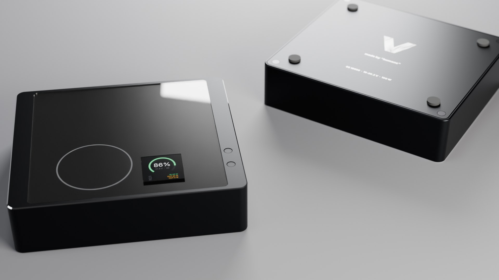
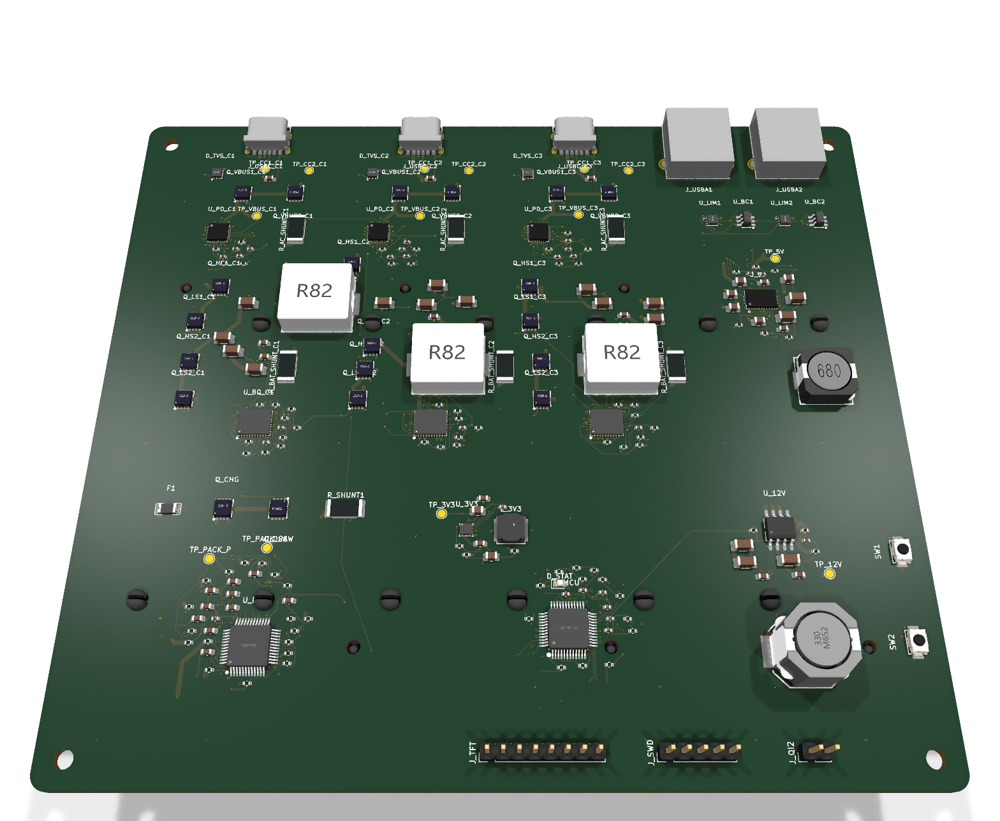
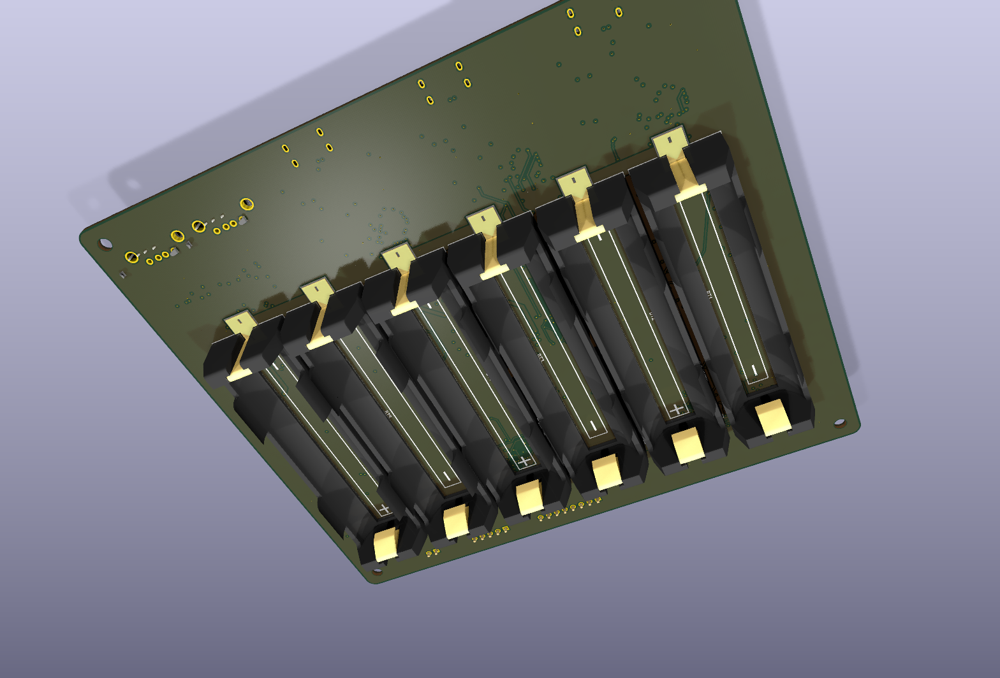
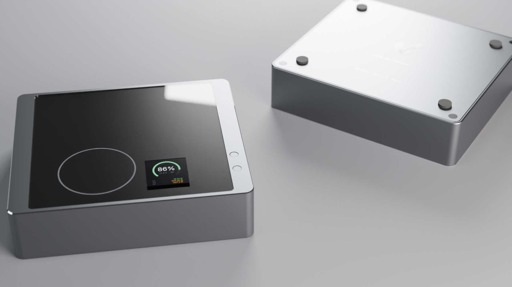
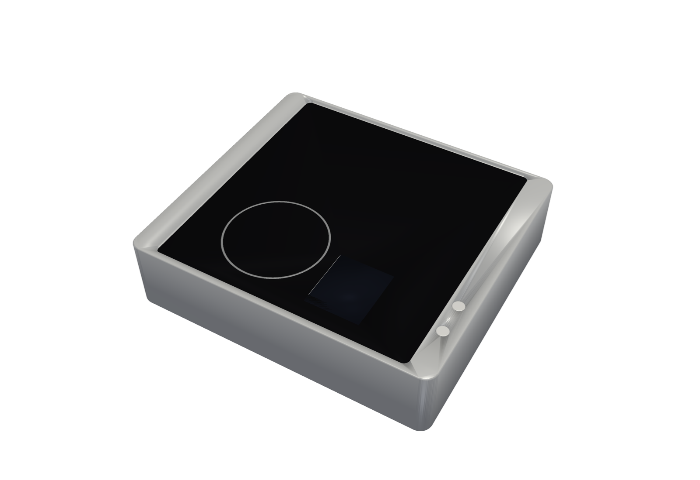
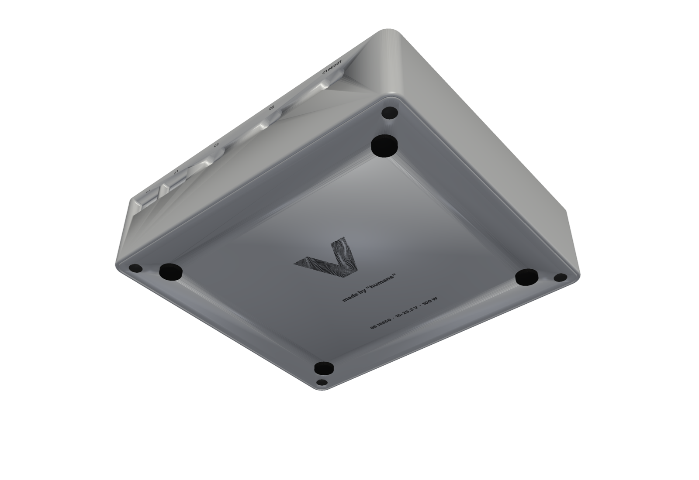

# powerbank-6s


A serious DIY power bank built around **six removable 18650 cells**. It's meant to last for years and charge a phone as fast as the wall charger does.

<p align="center">
  
</p>
<p align="center"><sub>158.6 × 142.6 × 39.2 mm, milled 6061 aluminium with a polished front edge and a glass front: Qi2 ring and colour display under the glass, cell door with laser marking on the back.</sub></p>

## PCB Preview (4-Layer, 152 × 136 mm)

| Top — Power, PD/PPS, BMS & MCU | Bottom — 6× Removable 18650 Holders |
|---|---|
|  |  |

## Highlights

- **45W Super Fast Charging 2.0** for the Galaxy S24+ (USB PD 3.0 PPS), and **65W** for laptops
- **3x USB-C + 2x USB-A**. Each USB-C port has its own converter, so all of them work at full speed at the same time
- **Removable cells (6S1P)**: insert cells at any voltage, the BMS balances them, and you can pull them out fully charged
- **Pass-through charging**: one wall charger fills the pack and your phone overnight
- **Solar input**: plug a foldable USB-C panel into C1 (the charger tracks the panel's maximum power point)
- **Magnetic Qi2 wireless** charging under the glass front
- **Color display** showing every cell's voltage, watts in/out per port, and which slot has a problem
- **Real 6S BMS** with per-cell protection and balancing

## Enclosure (v1 model)

<p align="center">
  
</p>
<p align="center"><sub>Rendered in Blender from the real model: the case parts from <code>enclosure/case.py</code> (<code>enclosure/blender_scene.py</code>).</sub></p>

| Front: glass, Qi2 ring, display, buttons | Back: cell door, logo, feet, port labels |
|---|---|
|  |  |

- **158.6 × 142.6 × 39.2 mm**, milled 6061 aluminium body (~290 g) + 2.5 mm aluminium cell door (~145 g)
- **Glass front**: one 1.5 mm tempered glass, black inside, with a window for the display; the Qi2 coil sits right under it (wireless charging can't pass through aluminium)
- **Aluminium mid-frame under the glass** doubles as the heat sink: thermal pads carry the heat from the 12 converter MOSFETs and 4 inductors into the frame and the walls. The case is sealed, with no vents
- **Cell door**: 4 Torx screws into steel hex standoffs that also hold the board, so swapping cells never wears the aluminium threads. Cell polarity and slot numbers are engraved inside the door
- Port openings follow the connector datasheets, with recesses for the plug overmolds and engraved labels
- Model in [build123d](https://github.com/gumyr/build123d) (`enclosure/case.py`), collision check against the real board (`enclosure/check.py`, 0 collisions), FreeCAD file `enclosure/out/powerbank_case.FCStd`

## How it works

```
USB-C1  in/out  ── TPS25751S ── BQ25756 ──┐
USB-C2  out     ── TPS25751S ── BQ25756 ──┤
USB-C3  out     ── TPS25751S ── BQ25756 ──┼── 6S removable pack ── BQ76952 BMS
USB-A1/A2 5V    ── LM73605 ──────────────┤
Qi2 module 12V  ── LMR36520 ─────────────┤
STM32G071 + TFT ── LMR36506 ─────────────┘
```

Each USB-C port pairs a TI PD controller with a BQ25756 bidirectional buck-boost, which produces any voltage from 3.3 to 21V in 20mV steps. That fine control is what PPS needs. An STM32 handles the display, splits the power budget between ports, and decides when the pack is full.

Full architecture, BOM with JLCPCB stock/prices, cost estimate and the cell-testing procedure are in **[powerbank.md](powerbank.md)**.

## Specs (planned)

| | |
|---|---|
| Cells | 6x 18650 in series, removable (currently EVE ICR18650/26V) |
| Pack | 15–25.2V, ~55Wh with 2.55Ah cells, ~75Wh with 3.5Ah cells |
| USB-C | 3 ports, PD 3.0 + PPS, up to 65W each |
| USB-A | 2 ports, 5V / 2A, BC1.2 |
| Wireless | Qi2 15W (module) |
| Input | USB-C PD or solar panel on C1 |
| Total output | ~100W from the pack, shared between ports |

## Repo layout

```
powerbank.md          project documentation (start here)
connections.md        safety Wave 0, power tree, I2C map, MCU pinout
powerbank.kicad_*     KiCad 10 project (6 hierarchical sheets + 4-layer PCB)
enclosure/            case model (build123d), collision check, FreeCAD file, STEP for milling
images/               3D PCB and case renders
lib/                  symbols, footprints, 3D models (verified against datasheets)
datasheets/           datasheets for every chosen part
powerbank.tex/.pdf    printable writeup
```

## Status

- [x] Requirements, architecture, full BOM & Safety Wave 0
- [x] KiCad libraries + datasheets + footprint audit
- [x] Schematic (6 hierarchical sheets, 241 components, 0 ERC errors)
- [x] PCB (4-layer 152 × 136 mm, 0 DRC violations, 0 unconnected pads)
- [ ] Display FPC & Qi2 module finalization
- [ ] Firmware
- [x] Case v1 model (milled aluminium, glass front, FreeCAD)
- [ ] Case: measure the cell height in the holder, final Qi2 / display sizes, then milling

## License

[MIT](LICENSE) for the design files and documentation in this repo. Datasheets in `datasheets/` belong to their manufacturers. Footprints and 3D models in `lib/` were generated from EasyEDA/LCSC data.
